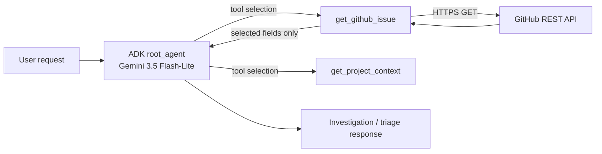

# Ragini Roy

### Applied AI Engineer | Agentic AI & LLM Systems | Backend Engineering

I build tool-using AI agents and LLM workflows, connect them to real APIs and interfaces, and evaluate how they behave.
Google ADK + Gemini agent with live GitHub tools. n8n + Gemini ticket automation. Deployed prompt-orchestrated agents on SmartlyLabs. Flask + Pinecone retrieval work at Asvix. GSSoC 2026 contributor.

---

## Highlights

| | |
|---|---|
| **Agent engineering** | A Google ADK agent that selects tools and pulls live GitHub issue data, an n8n agent that decides escalation and calls a sub-workflow as a tool, and prompt-orchestrated agents deployed on SmartlyLabs. |
| **Internship** | AI Full Stack Intern, Asvix Digital LLP. Works on Aroha's IDSP chatbot: Python, Flask, Gemini, Pinecone. Response evaluation and API docs. |
| **Open source** | Merged feature PR in HerStack-org/website. OpenCV.js feature in sahidawa-india. New agent in iloveAgents. |
| **GSSoC 2026** | Contributor on the Hybrid / AI Agents track. <!-- VERIFY rank/score before adding any number. Old text: "Top 100 global, score 782" vs "#27, score 526". --> |

---

## Selected Engineering Systems

### 1. AI Issue Triage Agent — Google ADK + Gemini + GitHub REST API
**Problem:** A bug report rarely contains enough evidence to triage it. The agent should decide what it needs, fetch it, then reason over it.
**Workflow:**

**What is implemented (V2):** Two registered tools. `get_github_issue(owner, repo, issue_number)` calls the GitHub REST API with `httpx` and returns only number, title, body, state, author and comment count. A non-200 response returns an error object to the agent. `get_project_context()` returns static project context, so the model does not guess about the project itself.
**Technical detail:** Raw API payloads never reach the model. The tool returns a reduced set of fields, which cuts token use and noise. The repo's own docs note this is data minimisation, not a prompt-injection defence.
**Roadmap (not built yet):** comments, repo tree, file and commit tools; structured triage output; MCP server; evaluation; guardrails. The repo README tracks V0–V14 and marks V3 onward as planned.
**Packaging:** Docker image `ragini777/ai-issue-triage-agent:v1` is documented in the repo (`DOCKERHUB_README.md`). <!-- VERIFY: Dockerfile is not in the repo; add it or link the Docker Hub page. -->
**Stack:** Python · Google ADK · Gemini · httpx · GitHub REST API
**Repo:** [github.com/Ragini-Roy7/ai-issue-triage-agent](https://github.com/Ragini-Roy7/ai-issue-triage-agent) · **Demo:** [Watch](https://drive.google.com/file/d/1g_3ZsdBL88YNYuzi0FQBbKRsLN79QoDV/view?usp=sharing)

### 2. n8n AI Ticket Automation
**Problem:** Support teams lose time sorting tickets and catching urgent ones.
**Trigger:** A ticket arrives via webhook or an n8n form, normalised to one JSON schema (name, email, subject, message).
**Gemini's role:** Classifies category, priority and sentiment, and writes a summary and recommended action, using a structured output parser.
**Decisions:** An AI agent decides whether to escalate (critical priority, payment/security concerns, or an explicit request for a human) and calls an escalation sub-workflow as a tool.
**Stack:** n8n · Gemini · AI agent · structured outputs · webhooks
**Repo:** [github.com/Ragini-Roy7/n8n-ai-ticket-automation](https://github.com/Ragini-Roy7/n8n-ai-ticket-automation) · **Demo:** [Watch](https://drive.google.com/file/d/1zW_8S4_wXaqwLDbCVjsjNOwx3-RUk-7p/view?usp=sharing)

### 3. AI/ML Guide Coach — deployed on SmartlyLabs
**Problem:** Generic AI assistants don't adapt to a learner's level or run realistic ML interview practice.
**How it works:** An intent classifier routes each query into Learning or Interview mode. A modular prompt orchestrator (system, learning and interview prompts) builds the response, and the SmartlyLabs runtime executes it. The workflow uses web search, Telegram and hooks. Interview mode runs Question → Answer → Evaluation → Follow-up → Feedback, with experience-aware study plans.
**Evaluation:** Every response is checked against six criteria: relevance, technical accuracy, adaptiveness, clarity, follow-up quality and educational value.
**Iteration:** Built across multiple versions, with structured user feedback used to tune prompts and behaviour. <!-- VERIFY: repo README says v1–v4 and 5 users at v2; your old profile said v5 and 6 feedback entries. Use whichever is current. -->
**My role:** Designed the agent, prompt modules and evaluation criteria; deployed and iterated it. <!-- VERIFY role wording -->
**Stack:** OpenAI GPT · Prompt engineering · SmartlyLabs runtime · Telegram · hooks · web search
**Repo:** [github.com/Ragini-Roy7/AI-ML-Guide-Coach-Agent](https://github.com/Ragini-Roy7/AI-ML-Guide-Coach-Agent)
**Demos:** [Interview mode video](https://drive.google.com/file/d/1aT9jTqvuScVEFfDuHvelB7BZyQBKhWa1/view?usp=sharing) · [Full demo folder](https://drive.google.com/drive/folders/1ph07UItSgmnK8v4QmBW-lhMVEMaK6Nhc?usp=sharing)

### 4. BrainBridge
Hackathon team project (TypeScript). I led the team and built and tested REST API endpoints with validation, JSON responses and error handling.
**Repo:** [github.com/Ragini-Roy7/BrainBridge](https://github.com/Ragini-Roy7/BrainBridge)

---

## Agentic AI & LLM Engineering

| Capability | Where I have used it |
|---|---|
| **Tool calling** | ADK tools for GitHub issue retrieval and project context (Issue Triage Agent). Escalation sub-workflow called as a tool by an n8n agent. |
| **Agent routing and orchestration** | Intent classification into Learning or Interview mode, with modular prompt orchestration (ML Guide Coach). |
| **Structured outputs** | Category, priority and sentiment schema via an output parser (n8n Ticket Automation). |
| **Context management** | Field-level filtering of API responses before they reach the model (Issue Triage Agent). |
| **LLM integrations** | Gemini (ADK, n8n, Asvix chatbot) and OpenAI GPT (ML Guide Coach). |
| **Retrieval (RAG)** | Pinecone embedding-based retrieval on the Aroha IDSP chatbot (Asvix internship). |
| **Workflow automation** | Webhooks and forms in n8n; Telegram and hooks on SmartlyLabs. |
| **Evaluation and feedback** | Six-criterion response rubric and user feedback (ML Guide Coach). Structured test cases against IDSP source data (Asvix). |

---

## Deployed AI Agents (SmartlyLabs)

Agents built, deployed and iterated on SmartlyLabs' agent infrastructure. Profile: [infra.smartlylabs.ai/profile/cmrujnenf002y04lbz7sapym1](https://infra.smartlylabs.ai/profile/cmrujnenf002y04lbz7sapym1) (agent chat pages require a SmartlyLabs sign-in).

- **AI/ML Guide Coach:** adaptive learning and mock-interview agent, described above.
- **SystemMind:** traces a problem through algorithms, memory, operating systems, networks, databases and hardware so learners see how systems work beneath abstractions. Research category, v1.
- <!-- VERIFY: add DevPilot / ML Interview Coach only with a one-line purpose that differs from the others, plus repo or demo link. -->

**Agent tuning:** I also contribute accepted tuning work on the SmartlyLabs Intelligence track, for example output JSON reliability and stale-data retrieval in a data-collection step.

---

## Engineering Experience & Open Source

**AI Full Stack Intern — Asvix Digital LLP** · Sept 2026 – Present
- Contribute to Aroha ([Aroha-V/Aroha](https://github.com/Aroha-V/Aroha)), a team project, on its IDSP AI chatbot: Python/Flask backend, Gemini generation, Pinecone embedding-based retrieval.
- Evaluate agent responses against IDSP source data using structured test cases, and refine prompts from the results.
- Write API documentation for the Aroha backend.
<!-- VERIFY: no commits under your name on Aroha's main branch. Link your merged or open PRs here, or say "contributions tracked in the Asvix fork". -->

**Virtual EduSkills Internship — TensorFlow / Machine Learning**
- Exposure to TensorFlow, ML and deep learning fundamentals, and ML workflows (learning stage).

**GirlScript Summer of Code 2026 — Hybrid / AI Agents track**
<!-- Hacktoberfest: add only once merged PRs are confirmed -->

| Repository | What I contributed | Area | PR | Status |
|---|---|---|---|---|
| RatLoopz/sahidawa-india | OpenCV.js packaging-geometry detection in the barcode scanner: lazy-loaded OpenCV.js, a periodic camera-frame detection hook, tests/fixtures (closes #3857) | Feature (computer vision, frontend) | [#3943](https://github.com/RatLoopz/sahidawa-india/pull/3943) | Merged <!-- VERIFY --> |
| HerStack-org/website | Project-Based Learning Track: beginner→advanced ML project roadmap, homepage ProjectPath section, concept-page "Put It Into Practice" links, nav link (closes #167) | Feature, docs, UI (React) | [#174](https://github.com/HerStack-org/website/pull/174) | **Merged** (Aug 17, 2026) |
| AditthyaSS/iloveAgents | DSA Progress Analyzer agent: turns a pasted practice log into a report of weak/strong topics, mistake patterns, next problems and a weekly action item (closes #780) | New agent | [#788](https://github.com/AditthyaSS/iloveAgents/pull/788) | Merged <!-- VERIFY --> |

---

## Engineering Capabilities

| Area | Skills |
|---|---|
| **AI systems (built)** | LLM agents with Google ADK and Gemini · tool calling · prompt orchestration (OpenAI, Gemini) · structured outputs · evaluation rubrics and test cases |
| **Automation & integrations (built)** | n8n workflows · webhooks · Telegram integration · GitHub REST API |
| **Backend (used in projects)** | Python · Flask · REST APIs · Pinecone · JavaScript/React · SQL |
| **Working knowledge** | Java · MongoDB · MySQL · scikit-learn · Firebase Auth · JWT · Docker (published a v1 image) |
| **Learning** | TensorFlow · RAG at scale · automated testing of agents |

---

## Coding Profiles & Contact

[LeetCode](https://leetcode.com/u/Ragini_Roy/) · [GeeksforGeeks](https://www.geeksforgeeks.org/profile/raginij1c) · [Kaggle](https://www.kaggle.com/ragini2002) · [HackerRank](https://www.hackerrank.com/profile/raginicodes)

[Email](mailto:raginicodes@gmail.com) · [LinkedIn](https://www.linkedin.com/in/ragini-roy-56231b25a/) · [SmartlyLabs profile](https://infra.smartlylabs.ai/profile/cmrujnenf002y04lbz7sapym1)
